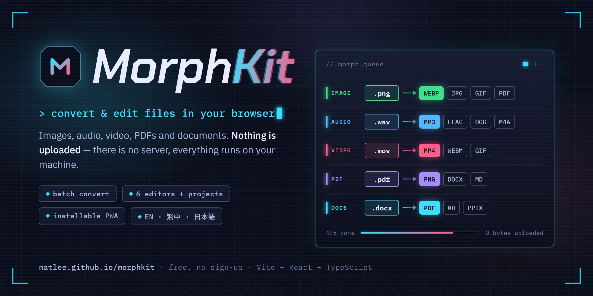
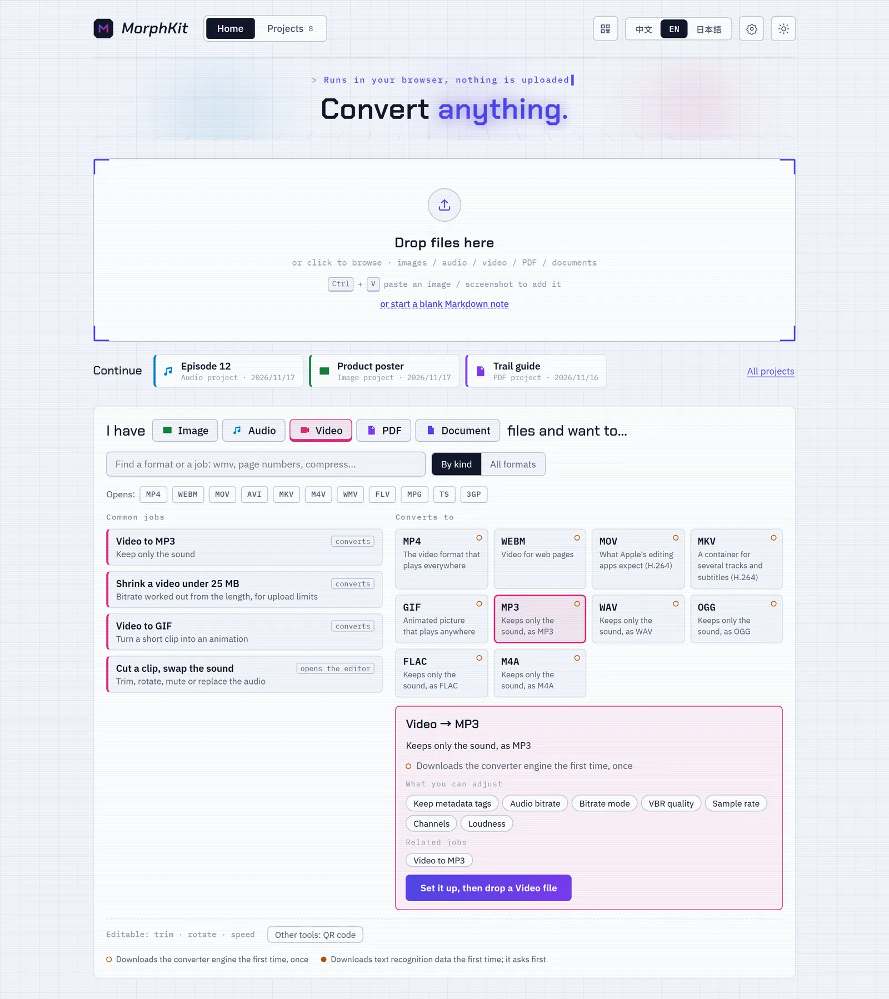
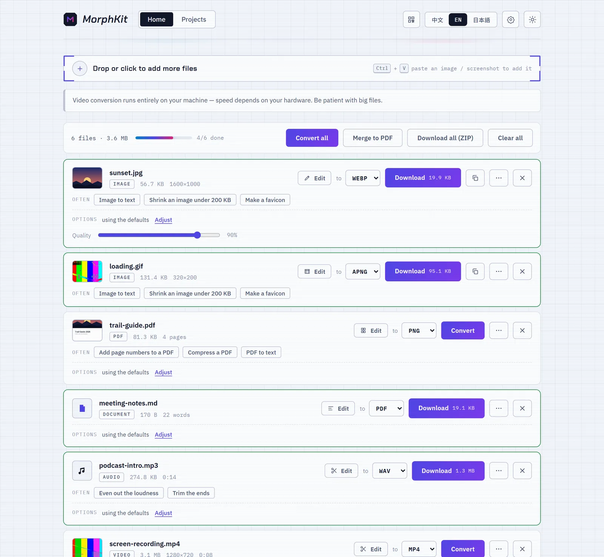
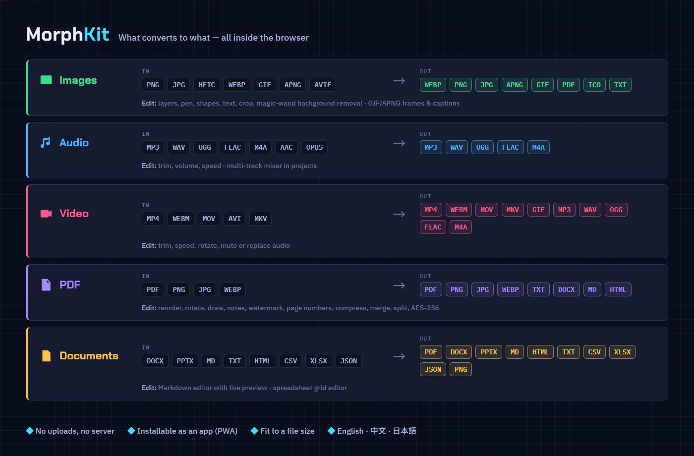
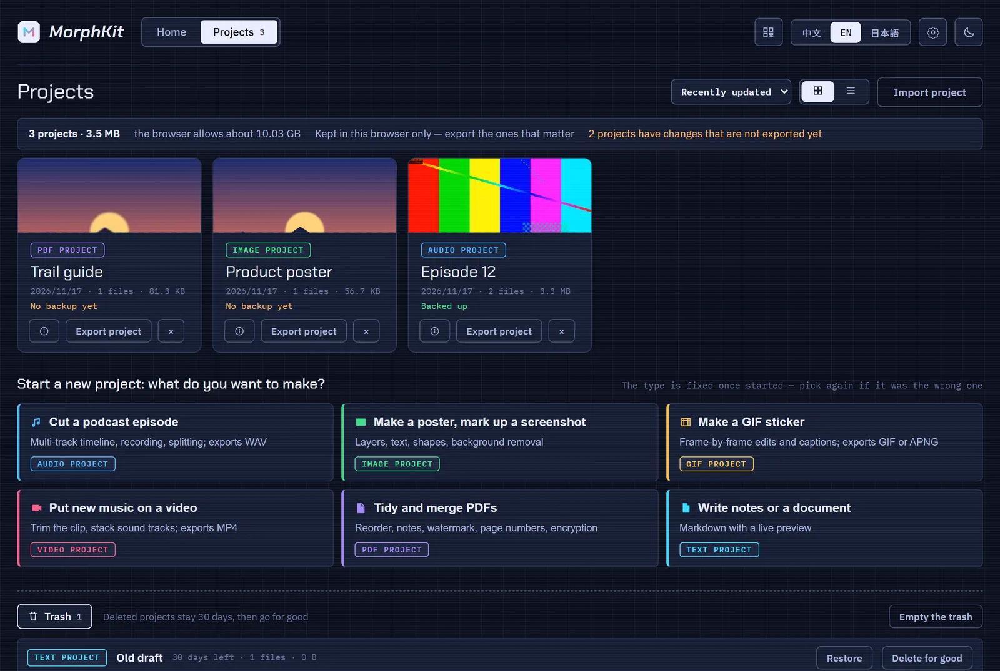
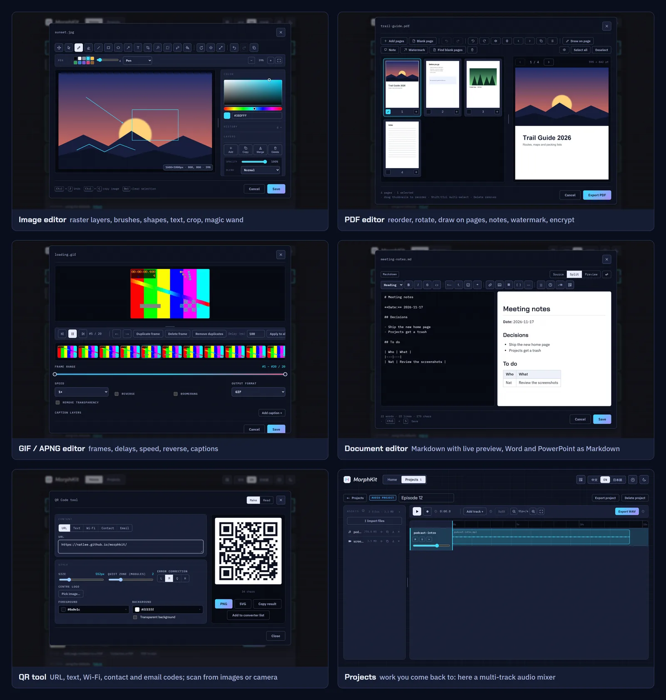
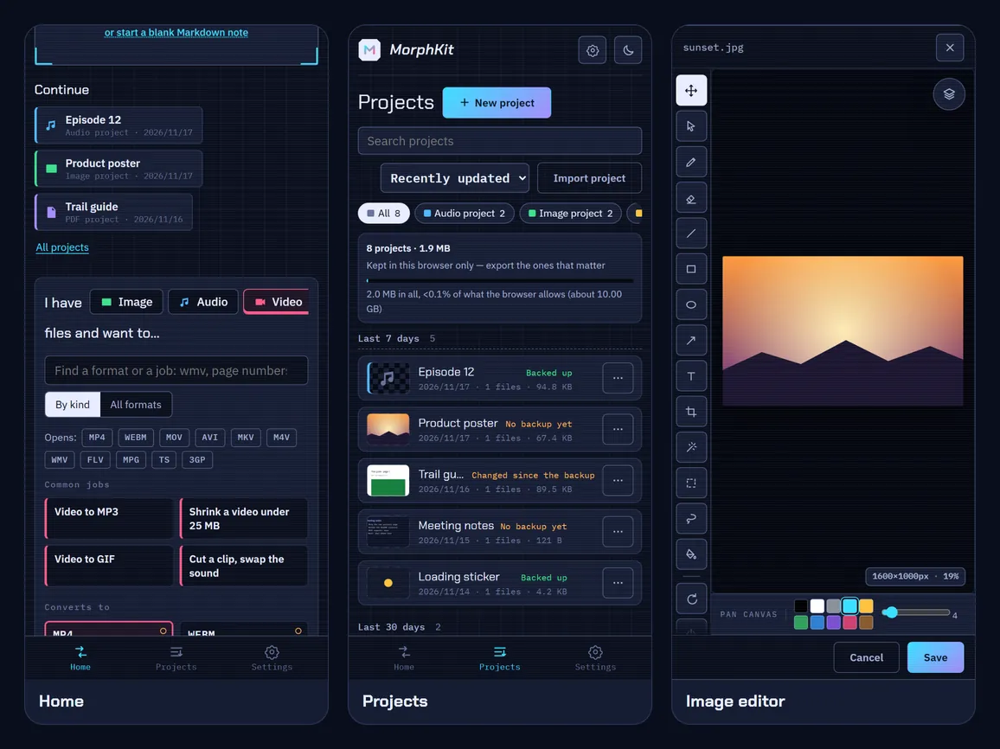

# MorphKit

[English](README.md) | [繁體中文](README.zh-TW.md)

[](https://github.com/NatLee/morphkit/actions/workflows/deploy.yml)
[](https://natlee.github.io/morphkit/)

[](LICENSE)

MorphKit is a file converter and a set of small editors that run entirely in your browser. Drop in
images, audio, video, PDFs or documents, pick an output format, and download the result — nothing is
uploaded, because there is no server. It is a static site, so it works on GitHub Pages as is and can be
installed as an app (PWA).

**Try it:** <https://natlee.github.io/morphkit/>

<picture>
  <source media="(prefers-color-scheme: dark)" srcset="docs/images/start-en-dark.webp">
  
</picture>

Add files, and each one gets a card: the output format, the three jobs most often done with that kind
of file, and its own options.

<picture>
  <source media="(prefers-color-scheme: dark)" srcset="docs/images/home-en-dark.webp">
  
</picture>

## What it converts



## Features

**Converter**

- Batch conversion with overall progress, *Convert all*, *Download all (ZIP)* and *Merge to PDF*
  (every image and PDF in the list becomes one PDF).
- Images through the Canvas API with a quality slider; GIF ⇄ APNG keeps every frame, APNG keeps
  full transparency, GIF output keeps 1-bit transparency or flattens onto a colour.
- Any image to an ICO icon (favicon) holding 16 – 256 px versions, each no bigger than the original,
  centred on a transparent square.
- Audio and video through [ffmpeg.wasm](https://ffmpegwasm.netlify.app/) (single-thread core, so no
  special server headers are needed), with 1–4 parallel workers. Tags and cover art are carried over
  where the target format supports them. A video can also become any of the audio formats (MP3, WAV,
  OGG, FLAC, M4A); one without a sound track says so instead of failing vaguely.
- PDF pages to PNG / JPG / WEBP (one ZIP for multi-page files), PDF text to TXT / DOCX / Markdown / HTML,
  password-protected PDFs unlocked in memory.
- Documents through one sanitised-HTML pipeline: Word, PowerPoint, Markdown, HTML, text, CSV / TSV,
  Excel / ODS and JSON. PDF output embeds Noto fonts so the text stays selectable, including CJK.
- File details per type: dimensions, duration, bitrate, page count, word count, photo EXIF with GPS
  and a map link, and QR codes found inside images.
- **"I want to…"** on the home page: 23 common jobs you can search or filter by file type, such as
  "Add page numbers to a PDF", "Shrink a video under 25 MB" or "Image to text". Pick one and add the
  file, or add the file first: each card suggests the three jobs most often done with that kind of file.
- Paste with Ctrl+V: a file or screenshot joins the list, plain text becomes a new Markdown note.
- **Fit to a file size** for upload limits: pick a target (100 KB – 5 MB for images, 10 – 100 MB for
  video) and each image is squeezed under it (quality first, then dimensions), while MP4 / WebM get
  the bitrate that lands the clip under it. Sizes are decimal, so "500 KB" means 500,000 bytes and the
  result passes the limit however the site counts.
- **Text recognition (OCR)**: pull the text out of a photo or screenshot (image → TXT), and scanned PDF
  pages are read the same way when you export a PDF as TXT, Markdown, HTML or Word. Traditional and
  Simplified Chinese, Japanese, Korean and English. The engine and language data (about 4–8 MB) download
  only after you say yes, once, and stay in the browser; the files themselves never leave it.
- **Even loudness**: make every file land at the same level, −14 LUFS for streaming, −16 for podcasts
  or −23 for broadcast. It measures the sound first and then moves the whole level once, so nothing
  gets squashed; the sound of MP4 / WebM output is levelled too.
- **Options per file**: every card lists the settings that change its own conversion (a size target for
  this video, loudness for that recording) and shows what differs from the defaults as chips you can
  remove. The drawer holds the defaults for new files.
- A settings drawer for image size caps, size targets and the text recognition language, audio
  bitrate / VBR / sample rate / channels / loudness, video CRF / size target / preset / resolution /
  frame rate, GIF frame rate and width, PDF render resolution and document page size.

**Editors** (open any file with *Edit*)

| Editor | What you can do |
|---|---|
| Image | Raster layers with opacity, blend modes and masks; pen / marker / highlighter, eraser, line, rectangle, ellipse, arrow, text, fill; crop, rotate, flip, resize; magic wand, rectangle and lasso selections; a full undo timeline |
| GIF / APNG | Film strip, play and step, per-frame delete / duplicate / reorder / delay, merge duplicate frames, trim, speed, reverse, boomerang, draggable captions, flatten transparency |
| PDF | Page grid with live preview; add pages from PDFs or images, blank pages, reorder, rotate, flip, draw on a page, sticky notes, watermark, find blank pages; export all or some pages with page numbers and smaller images, split to ZIP, AES-256 encryption |
| Document | Markdown with a formatting toolbar and live preview; Word and PowerPoint files edit as Markdown and are rebuilt on save |
| Spreadsheet | Grid editor for CSV / TSV / XLSX / XLS / ODS with sheet tabs, row and column insert / move / delete and sorting |
| Audio / video | Trim with a two-handle timeline, volume, speed, rotate, mute or replace the audio track |

**Projects** (called Studio until November 2026) are for work you come back to. They are kept in the browser (IndexedDB), and the page says so up front, with how much space they take. Each project shows whether its latest state has been exported as a backup, and a deleted project waits 30 days in a trash before it is gone for good.



What a project can be: a multi-track audio mixer with recording and WAV
export, video projects that export MP4 with the mixed audio, and image, GIF, PDF and text projects
that keep their layers and edits. Projects can be exported and imported as ZIP files.

**QR tool** makes codes for URLs, text, Wi-Fi, contacts and email (colours, size, quiet zone, error
correction, centre logo; PNG or SVG) and reads them from images, the clipboard or the camera.

The interface comes in English, 繁體中文 and 日本語, with light, dark and follow-the-system themes.



It is built for phones too — the editors switch to a full-screen, app-style layout:



## Run it locally

You need Node.js 22.13 or newer (CI uses the major version in `.nvmrc`).

```bash
git clone https://github.com/NatLee/morphkit.git
cd morphkit
npm ci
npm run dev        # dev server with hot reload
```

Other scripts:

```bash
npm test           # unit tests (Vitest + jsdom)
npm run build      # type-check, then build the static site into dist/
npm run preview    # serve dist/ locally, with the service worker
```

The service worker only registers in production builds, so use `npm run preview` when you want to
test the installable app or the offline shell.

## Deploy to GitHub Pages

The site is plain static files built with `base: './'`, so it works under any repository name.

1. Fork or push the repository to GitHub.
2. In **Settings → Pages → Build and deployment**, set **Source** to **GitHub Actions**.
3. Every push to `main` runs the tests, builds and deploys (`.github/workflows/deploy.yml`).
   The tests live in `.github/workflows/ci.yml`; pull requests run that workflow on its own, without deploying.

## What stays on your machine

Your files never leave the browser. The app does make a few network requests:

- the ffmpeg core (~31 MB) from unpkg, the first time you convert audio or video;
- Noto font subsets from Google Fonts when a document is turned into a PDF with selectable text
  (if that fails, the PDF falls back to rendered pages);
- the text recognition engine and language data (about 4–8 MB) from jsDelivr, the first time you
  read text from an image or a scanned PDF, and only after you agree in a dialog;
- the interface fonts (Chakra Petch and IBM Plex) from Google Fonts.

## Known limitations

- Browser memory tops out around 1.8–2 GB; bigger files fail, and the app warns before you try.
- ffmpeg.wasm is 5–20× slower than native ffmpeg; WEBM (VP8) encoding is especially slow.
- Animated images are decoded up to 300 frames; longer GIFs are cut off.
- PDF → TXT / DOCX / Markdown / HTML reads the text layer. A scanned PDF has none; the app says so
  and suggests PNG / JPG or an OCR tool instead (there is no OCR built in).
- Canvas WEBP export does not work in older Safari; copying results to the clipboard needs HTTPS.
- A video size target needs the clip's length, which comes from the browser. For a file the browser
  cannot play (some AVI / WMV / FLV), the card asks you to turn the target off instead of guessing.

## Working on the code

`npm test` and `npm run build` must pass (CI runs both on every pull request). Run
`npm run check:context` as well when you touch the structure of the code.

The code base comes with a written map, for people and coding assistants alike. Start with
`CLAUDE.md`, then open the map for the part you are changing:

| Document | What it covers |
|---|---|
| [`CLAUDE.md`](CLAUDE.md) | Commands, one line on every file in `src/`, the invariants (each one guards against a regression that really happened) and the design language |
| [`docs/claude/app-shell.md`](docs/claude/app-shell.md) | The converter: app state, how a conversion is routed, file cards, the settings drawer, small components |
| [`docs/claude/editors.md`](docs/claude/editors.md) | The image, GIF / APNG, PDF and document editors |
| [`docs/claude/studio.md`](docs/claude/studio.md) | Projects (the code still calls this part Studio), the audio mixer and video projects |
| [`docs/claude/libs.md`](docs/claude/libs.md) | Everything in `src/lib/`: ffmpeg arguments, formats, settings, PDF, documents, QR codes, translations |
| [`docs/claude/styles.md`](docs/claude/styles.md) | The sections of `styles.css`, the themes and the phone layout |
| [`docs/claude/README.md`](docs/claude/README.md) | How the maps are organised and kept up to date |
| [`.claude/skills/`](.claude/skills/) | Step-by-step recipes for adding a converter setting or an output format |

`npm run check:context` fails when a map names a file, function or CSS class that no longer exists,
when a file in `src/` has no line in `CLAUDE.md`, or when the three interface languages have
different keys. Update a map in the same commit as the code it describes.

The README pictures are in [`docs/images/`](docs/images/). The screenshots come from a script that drives the app
in headless Edge; they were last taken on 2026-11-17, after the entry redesign. [`cover.html`](docs/images/cover.html) is
the source of the cover and says how to render it again.

## License

[MIT](LICENSE). Use it, change it, host your own copy; keep the copyright notice.
