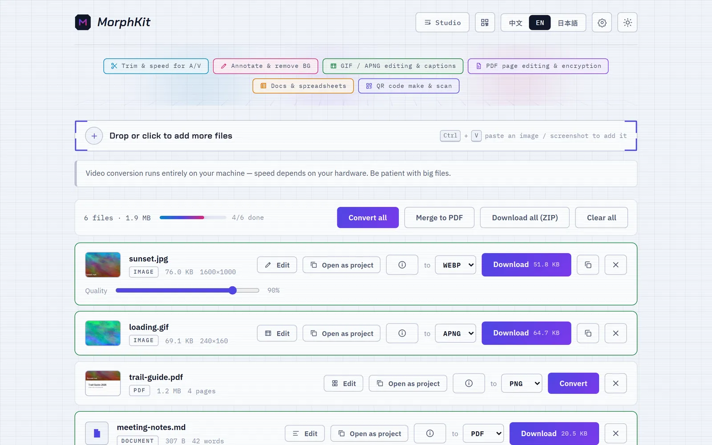
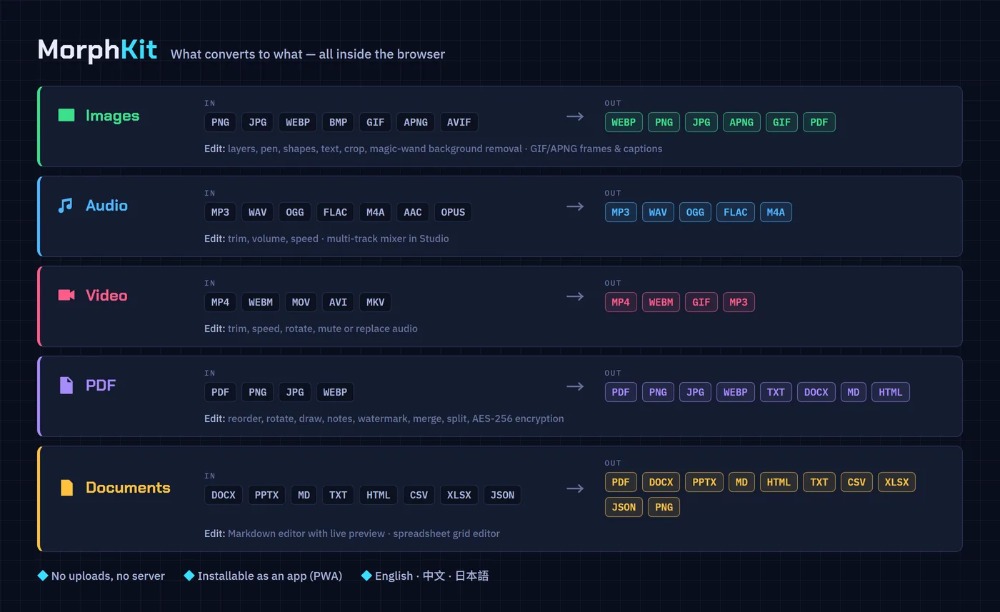
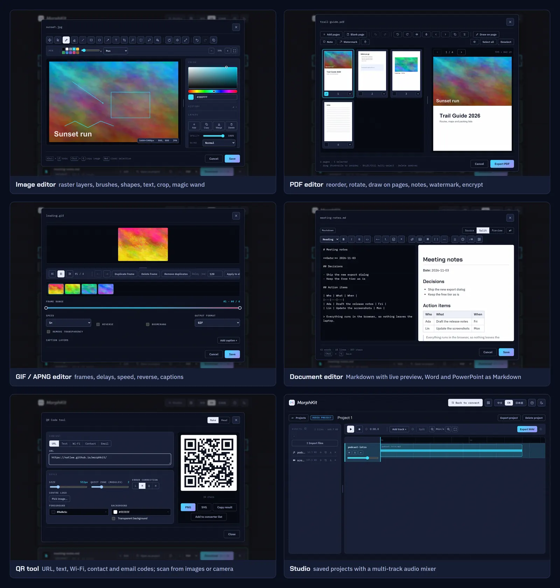
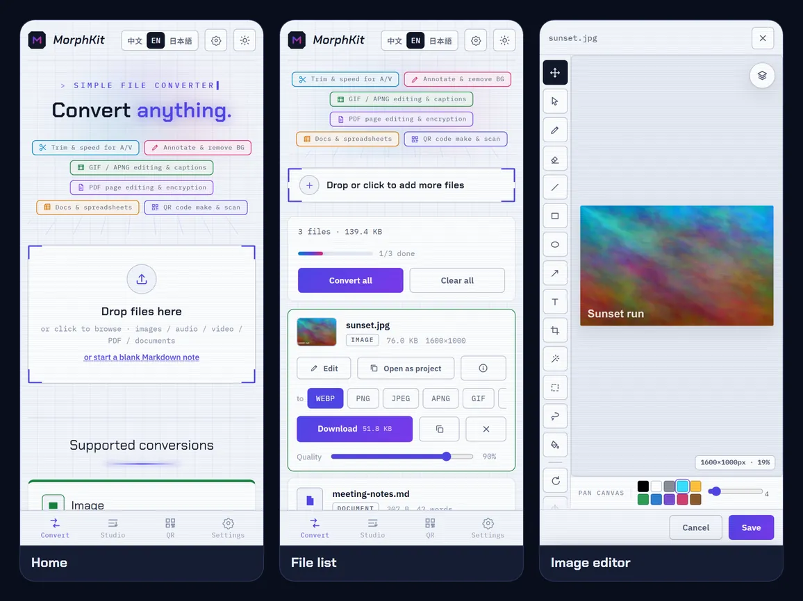

# MorphKit

[English](README.md) | [繁體中文](README.zh-TW.md)

[](https://github.com/NatLee/morphkit/actions/workflows/deploy.yml)
[](https://natlee.github.io/morphkit/)


MorphKit is a file converter and a set of small editors that run entirely in your browser. Drop in
images, audio, video, PDFs or documents, pick an output format, and download the result — nothing is
uploaded, because there is no server. It is a static site, so it works on GitHub Pages as is and can be
installed as an app (PWA).

**Try it:** <https://natlee.github.io/morphkit/>

<picture>
  <source media="(prefers-color-scheme: dark)" srcset="docs/images/home-en-dark.webp">
  
</picture>

## What it converts



## Features

**Converter**

- Batch conversion with overall progress, *Convert all*, *Download all (ZIP)* and *Merge to PDF*
  (every image and PDF in the list becomes one PDF).
- Images through the Canvas API with a quality slider; GIF ⇄ APNG keeps every frame, APNG keeps
  full transparency, GIF output keeps 1-bit transparency or flattens onto a colour.
- Audio and video through [ffmpeg.wasm](https://ffmpegwasm.netlify.app/) (single-thread core, so no
  special server headers are needed), with 1–4 parallel workers. Tags and cover art are carried over
  where the target format supports them.
- PDF pages to PNG / JPG / WEBP (one ZIP for multi-page files), PDF text to TXT / DOCX / Markdown / HTML,
  password-protected PDFs unlocked in memory.
- Documents through one sanitised-HTML pipeline: Word, PowerPoint, Markdown, HTML, text, CSV / TSV,
  Excel / ODS and JSON. PDF output embeds Noto fonts so the text stays selectable, including CJK.
- File details per type: dimensions, duration, bitrate, page count, word count, photo EXIF with GPS
  and a map link, and QR codes found inside images.
- Paste with Ctrl+V: a file or screenshot joins the list, plain text becomes a new Markdown note.
- A settings drawer for image size caps, audio bitrate / VBR / sample rate / channels, video CRF /
  preset / resolution / frame rate, GIF frame rate and width, PDF render resolution and document page
  size.

**Editors** (open any file with *Edit*)

| Editor | What you can do |
|---|---|
| Image | Raster layers with opacity, blend modes and masks; pen / marker / highlighter, eraser, line, rectangle, ellipse, arrow, text, fill; crop, rotate, flip, resize; magic wand, rectangle and lasso selections; a full undo timeline |
| GIF / APNG | Film strip, play and step, per-frame delete / duplicate / reorder / delay, merge duplicate frames, trim, speed, reverse, boomerang, draggable captions, flatten transparency |
| PDF | Page grid with live preview; add pages from PDFs or images, blank pages, reorder, rotate, flip, draw on a page, sticky notes, watermark, export all or some pages, split to ZIP, AES-256 encryption |
| Document | Markdown with a formatting toolbar and live preview; Word and PowerPoint files edit as Markdown and are rebuilt on save |
| Spreadsheet | Grid editor for CSV / TSV / XLSX / XLS / ODS with sheet tabs, row and column insert / move / delete and sorting |
| Audio / video | Trim with a two-handle timeline, volume, speed, rotate, mute or replace the audio track |

**Studio** keeps projects in the browser (IndexedDB): a multi-track audio mixer with recording and WAV
export, video projects that export MP4 with the mixed audio, and image, GIF, PDF and text projects
that keep their layers and edits. Projects can be exported and imported as ZIP files.

**QR tool** makes codes for URLs, text, Wi-Fi, contacts and email (colours, size, quiet zone, error
correction, centre logo; PNG or SVG) and reads them from images, the clipboard or the camera.

The interface comes in English, 繁體中文 and 日本語, with light, dark and follow-the-system themes.



It is built for phones too — the editors switch to a full-screen, app-style layout:



## Run it locally

You need Node.js 22.13 or newer (CI uses the major version in `.nvmrc`).

```bash
git clone https://github.com/NatLee/morphkit.git
cd morphkit
npm ci
npm run dev        # dev server with hot reload
```

Other scripts:

```bash
npm test           # unit tests (Vitest + jsdom)
npm run build      # type-check, then build the static site into dist/
npm run preview    # serve dist/ locally, with the service worker
```

The service worker only registers in production builds, so use `npm run preview` when you want to
test the installable app or the offline shell.

## Deploy to GitHub Pages

The site is plain static files built with `base: './'`, so it works under any repository name.

1. Fork or push the repository to GitHub.
2. In **Settings → Pages → Build and deployment**, set **Source** to **GitHub Actions**.
3. Every push to `main` runs the tests, builds and deploys (`.github/workflows/deploy.yml`).
   The tests live in `.github/workflows/ci.yml`; pull requests run that workflow on its own, without deploying.

## What stays on your machine

Your files never leave the browser. The app does make a few network requests:

- the ffmpeg core (~31 MB) from unpkg, the first time you convert audio or video;
- Noto font subsets from Google Fonts when a document is turned into a PDF with selectable text
  (if that fails, the PDF falls back to rendered pages);
- the interface fonts (Chakra Petch and IBM Plex) from Google Fonts.

## Known limitations

- Browser memory tops out around 1.8–2 GB; bigger files fail, and the app warns before you try.
- ffmpeg.wasm is 5–20× slower than native ffmpeg; WEBM (VP8) encoding is especially slow.
- Animated images are decoded up to 300 frames; longer GIFs are cut off.
- PDF → TXT / DOCX / Markdown / HTML reads the text layer. A scanned PDF has none; the app says so
  and suggests PNG / JPG or an OCR tool instead (there is no OCR built in).
- Canvas WEBP export does not work in older Safari; copying results to the clipboard needs HTTPS.

## Contributing

`npm test` and `npm run build` must pass. The file map, invariants and design notes for the code base
live in [`CLAUDE.md`](CLAUDE.md) and [`docs/claude/`](docs/claude/); `npm run check:context` checks
that they still match the source.
