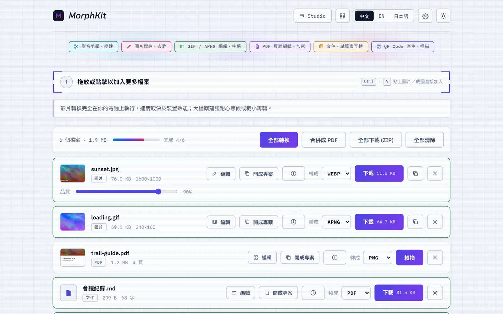
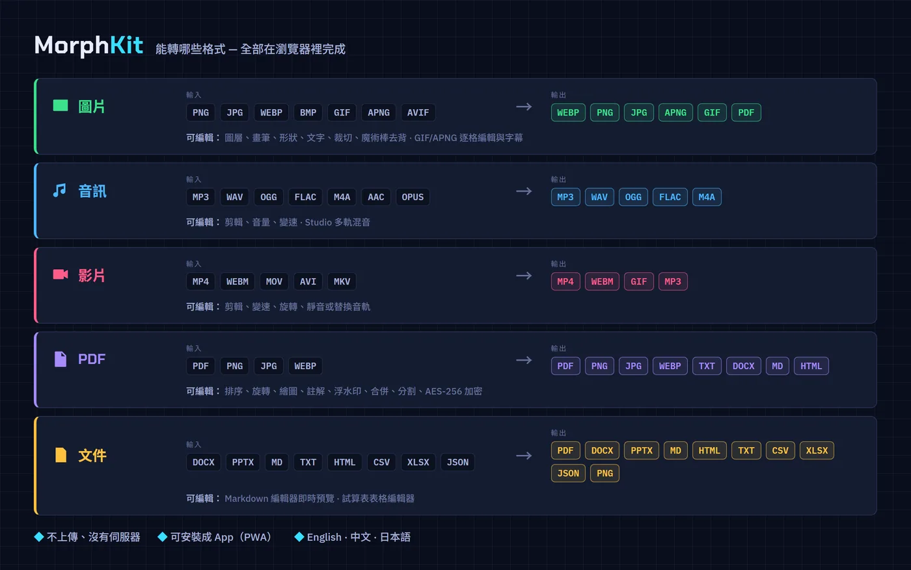
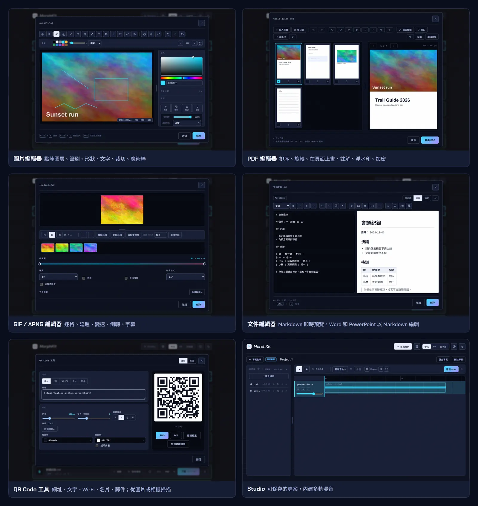
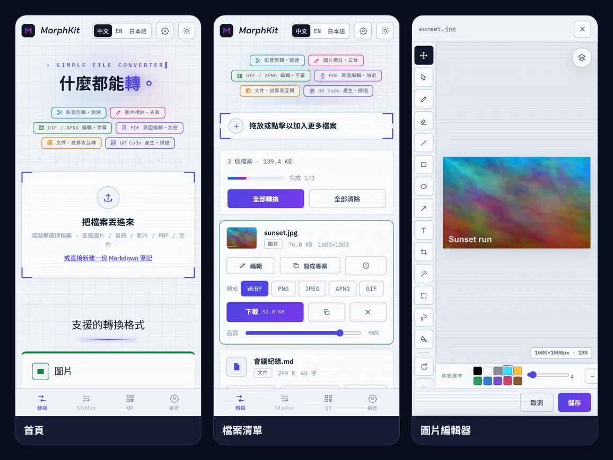

# MorphKit

[English](README.md) | [繁體中文](README.zh-TW.md)

[](https://github.com/NatLee/morphkit/actions/workflows/deploy.yml)
[](https://natlee.github.io/morphkit/)


MorphKit 是一個完全在瀏覽器裡執行的轉檔工具，附帶幾個小型編輯器。把圖片、音訊、影片、PDF 或文件丟進來，選好輸出格式就能下載。檔案不會上傳，因為根本沒有伺服器。整個網站都是靜態檔案，直接放在 GitHub Pages 就能用，也可以安裝成 App（PWA）。

**線上試用：** <https://natlee.github.io/morphkit/>

<picture>
  <source media="(prefers-color-scheme: dark)" srcset="docs/images/home-zh-dark.webp">
  
</picture>

## 能轉哪些格式



## 功能

**轉檔**

- 批次轉換：顯示整體進度，可以「全部轉換」、「全部下載（ZIP）」，也能把清單裡的圖片和 PDF「合併成 PDF」。
- 圖片用 Canvas API 轉，附品質滑桿。GIF ⇄ APNG 會保留每一格；APNG 保留完整透明度；GIF 可以保留一位元透明，或壓在指定的底色上。
- 音訊和影片用 [ffmpeg.wasm](https://ffmpegwasm.netlify.app/)（瀏覽器版 ffmpeg）轉。用的是單執行緒版本，伺服器不需要特別設定；可以同時開 1–4 個轉換引擎。目標格式支援時，標籤和專輯封面會一起保留。
- PDF 頁面轉成 PNG / JPG / WEBP（多頁時打包成 ZIP）；PDF 文字可以轉成 TXT / DOCX / Markdown / HTML。有密碼的 PDF 在記憶體裡解鎖，密碼不會被存起來。
- 文件統一先轉成清理過的 HTML，再轉成目標格式：支援 Word、PowerPoint、Markdown、HTML、純文字、CSV / TSV、Excel / ODS 和 JSON。輸出 PDF 時會嵌入 Noto 字型，文字可以選取，中日韓文也沒問題。
- 依檔案類型顯示資訊：尺寸、長度、位元率、頁數、字數，照片的 EXIF 和 GPS（附地圖連結），以及圖片裡的 QR Code。
- 按 Ctrl+V 貼上：檔案或截圖會加進清單；純文字會變成一份新的 Markdown 筆記。
- 設定面板：圖片最長邊；音訊位元率、VBR、取樣率、聲道；影片 CRF、preset、解析度、幀率；GIF 幀率和寬度；PDF 轉圖解析度；文件頁面大小。

**編輯器**（按檔案上的「編輯」）

| 編輯器 | 可以做什麼 |
|---|---|
| 圖片 | 點陣圖層，可調不透明度、混合模式和遮罩；鋼筆 / 麥克筆 / 螢光筆、橡皮擦、直線、矩形、橢圓、箭頭、文字、油漆桶；裁切、旋轉、翻轉、縮放；魔術棒、矩形和套索選取；完整的復原歷史 |
| GIF / APNG | 影格縮圖條、播放和逐格；逐格刪除 / 複製 / 排序 / 調延遲；合併重複影格、剪裁範圍、變速、倒轉、來回播放；可拖曳的字幕；壓平透明 |
| PDF | 頁面縮圖加即時預覽；從 PDF 或圖片加頁、空白頁、排序、旋轉、翻轉、在頁面上畫、便利貼註解、浮水印；輸出全部或部分頁面、分割成 ZIP、AES-256 加密 |
| 文件 | Markdown 附格式工具列和即時預覽；Word 和 PowerPoint 會以 Markdown 編輯，存檔時重新產生原格式 |
| 試算表 | CSV / TSV / XLSX / XLS / ODS 表格編輯：工作表分頁，插入 / 移動 / 刪除列和欄，排序 |
| 音訊 / 影片 | 雙把手時間軸剪輯、音量、變速、旋轉、靜音或替換音軌 |

**Studio** 把專案存在瀏覽器裡（IndexedDB）：多軌混音，可以錄音、匯出 WAV；影片專案會把混好的聲音一起匯出成 MP4；圖片、GIF、PDF 和文字專案會保留圖層和編輯內容。專案可以匯出、匯入成 ZIP。

**QR Code 工具** 可以產生網址、文字、Wi-Fi、名片和郵件的 QR Code（可調顏色、大小、留白、容錯等級、中央 Logo，輸出 PNG 或 SVG），也能從圖片、剪貼簿或相機讀取。

介面有 English、繁體中文、日本語三種語言，以及淺色、深色、跟隨系統三種主題。



手機也能用，編輯器會切換成全螢幕、像 App 一樣的版面：



## 在本機執行

需要 Node.js 22.13 以上（CI 用的主版本寫在 `.nvmrc`）。

```bash
git clone https://github.com/NatLee/morphkit.git
cd morphkit
npm ci
npm run dev        # 開發伺服器，改程式會自動重新載入
```

其他指令：

```bash
npm test           # 單元測試（Vitest + jsdom）
npm run build      # 先做型別檢查，再把靜態網站打包到 dist/
npm run preview    # 在本機開 dist/，包含 service worker
```

service worker（讓網站能安裝、離線開啟的背景程式）只在正式版註冊。要測試安裝或離線開啟，請用 `npm run preview`。

## 部署到 GitHub Pages

打包時用 `base: './'`，所以 repo 叫什麼名字都能用。

1. Fork 或把 repo 推到 GitHub。
2. 到 **Settings → Pages → Build and deployment**，把 **Source** 設成 **GitHub Actions**。
3. 之後每次推到 `main`，都會跑測試、打包並部署（`.github/workflows/deploy.yml`）。測試寫在 `.github/workflows/ci.yml`，pull request 只跑這一份，不會部署。

## 哪些東西會連網

你的檔案不會離開瀏覽器。不過 App 本身會發出幾個網路請求：

- 第一次轉音訊或影片時，從 unpkg 下載 ffmpeg 核心（約 31 MB）。
- 文件轉成「文字可選取」的 PDF 時，從 Google Fonts 下載需要的 Noto 字型片段。下載失敗時會改用圖片頁面輸出。
- 介面字型（Chakra Petch、IBM Plex）來自 Google Fonts。

## 已知限制

- 瀏覽器記憶體上限約 1.8–2 GB，更大的檔案會失敗；加入檔案時 App 會先提醒。
- ffmpeg.wasm 比原生 ffmpeg 慢 5–20 倍，WEBM（VP8）編碼特別慢。
- 動畫圖片最多解碼 300 格，更長的 GIF 會被截斷。
- PDF 轉 TXT / DOCX / Markdown / HTML 讀的是文字層，掃描的 PDF 會得到空白結果。
- 舊版 Safari 不支援 Canvas 輸出 WEBP；把結果複製到剪貼簿需要 HTTPS。

## 參與開發

`npm test` 和 `npm run build` 都要通過。程式的檔案地圖、不變條件和設計說明在 [`CLAUDE.md`](CLAUDE.md) 和 [`docs/claude/`](docs/claude/)；`npm run check:context` 會檢查這些說明是否還跟程式一致。
